# Pre-Mortem Dispatch

**Distribution intelligence for TRIWIZATHON 2026.** Build a baseline allocation, break it with a
simulated disruption, measure the damage, and get a constraint-checked recovery plan — with every
number computed, not narrated.

> *"If this distribution plan fails under a specific disruption, what is affected, what can be
> recovered, what will it cost, and what should we do next?"*

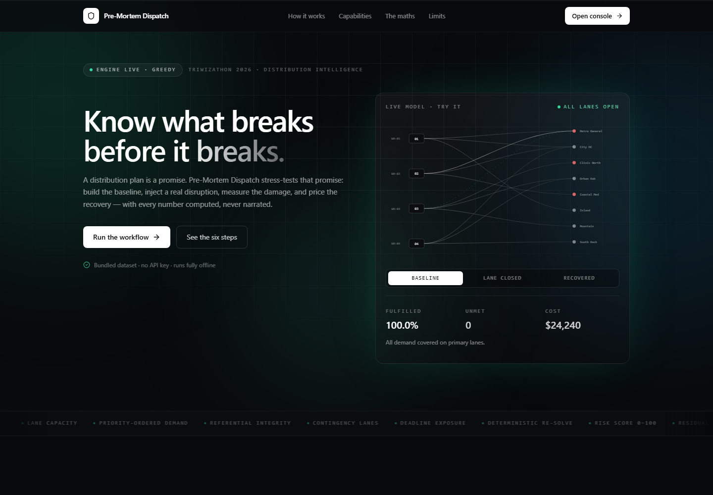

---

## What it actually does

| Step | Screen | What happens |
|---|---|---|
| 1 | **Datasets** | Load a bundled 4-warehouse / 8-destination network, or upload six CSVs. Schema, type, duplicate and referential checks run before anything is planned. |
| 2 | **Planner** | Solves a constrained allocation: inventory, lane capacity, lane availability, product eligibility, destination priority — and, optionally, destination deadlines as a hard constraint. Shows every shipment, every gap, and the risk-score breakdown. |
| 3 | **Disruption Lab** | Mutates *real planning inputs* — reduced stock, zeroed supply, a closed lane, or added transit days — alone or up to five at once, applied in order. Impact is the difference between two computed plans. |
| 4 | **Recovery** | Re-plans using contingency lanes and priority ordering, lists each concrete allocation change with its unit cost, and names the constraint behind every residual gap. |
| 5 | **Compare** | Baseline / disrupted / recovered side by side, with server-computed deltas and a written trade-off. |
| 6 | **Exports** | CSV built from the stored plan data, so it matches the screen exactly. |

### The demo story in numbers (bundled sample network)

| Plan | Fulfilment | Unmet | Cost |
|---|---|---|---|
| Baseline | **100.0%** | 0 | $24,240 |
| Close lane `RT-03` | **89.9%** | 500 | $22,620 |
| Recovery (activates `RT-13`, `RT-16`, `RT-19`) | **100.0%** | 0 | **$26,030** (+$3,410) |

That is the whole product in one line: *closing a lane costs 500 units of demand; buying it back
through contingency capacity costs $3,410.*

If recovery genuinely cannot cover demand, the app returns the residual gaps and names the
limiting destination×product rows. It never reports a success it cannot compute.

### Scenario engine

- **Compound failures** — combine up to five disruptions in one scenario. Events apply in
  order, so a second shortage on the same stock compounds on the first, and repeating a lane
  closure is idempotent.
- **Explained gaps** — every unmet row carries a cause computed from the plan's own inputs:
  no lane, product filter, deadline, stock, lane capacity, or capacity/stock consumed by
  earlier demand. The badge tooltip shows the supporting numbers.
- **Named, disposable scenarios** — name a run, rename it, and delete it together with its
  disrupted/recovered plans. The baseline plan is never deleted.
- **Severity sweeps** — for stock shortages and lane delays, re-solve 2–7 severity points
  against the same baseline. Shortage curves chart fulfilment and unmet units; delay curves
  chart deadline exposure, because volume stays at 100%. Each point names its dominant cause,
  and no scenario or plan is stored.

### Screens

The app opens on a **landing page** (`/`) with an **interactive network model**: switch between
*baseline → lane closed → recovered* and the diagram, the counters and the note all change to the
real computed figures. Every CTA routes into the console.

| | |
|---|---|
|  | 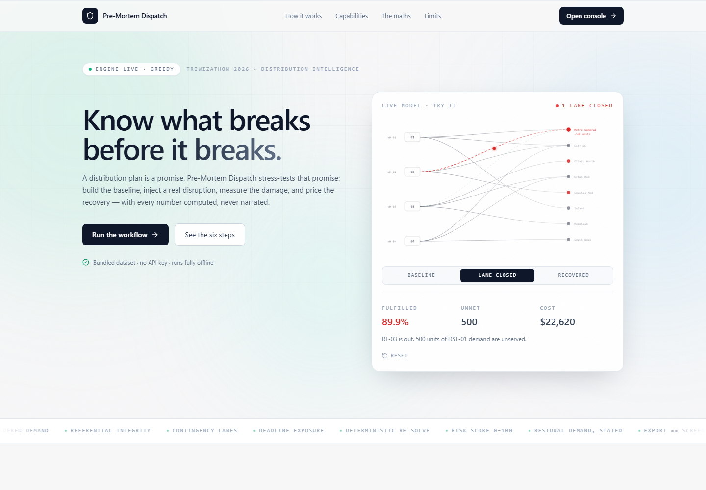 |
| **Baseline** — all lanes open, 100.0% fulfilled | **Lane closed** — RT-03 out, 500 units unserved |
| 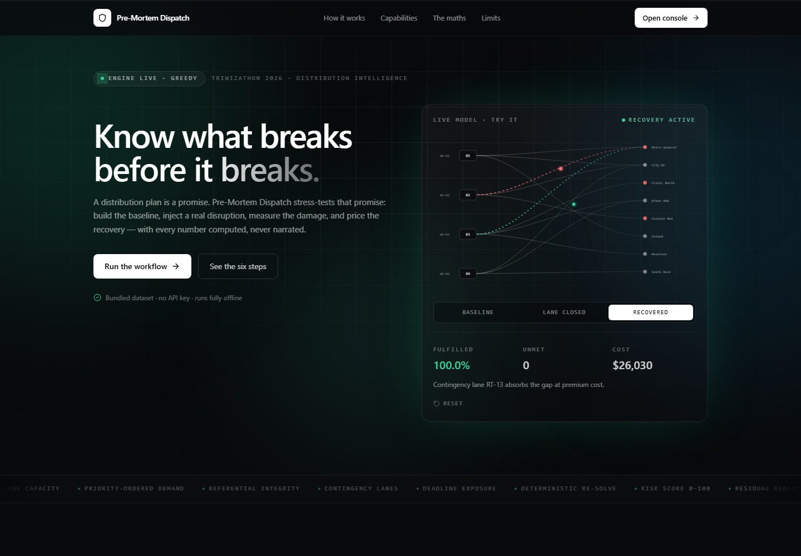 | 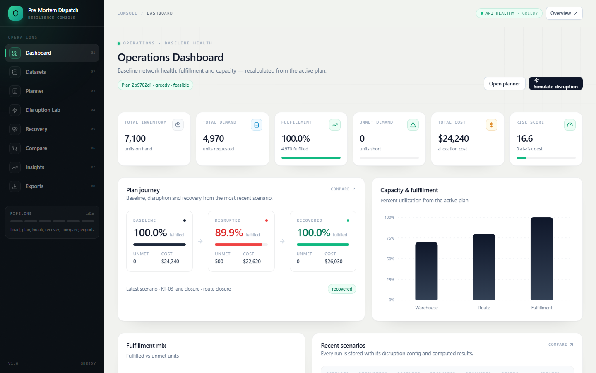 |
| **Recovered** — contingency RT-13 absorbs the gap | **Dashboard** — KPIs, capacity, scenario history |
| 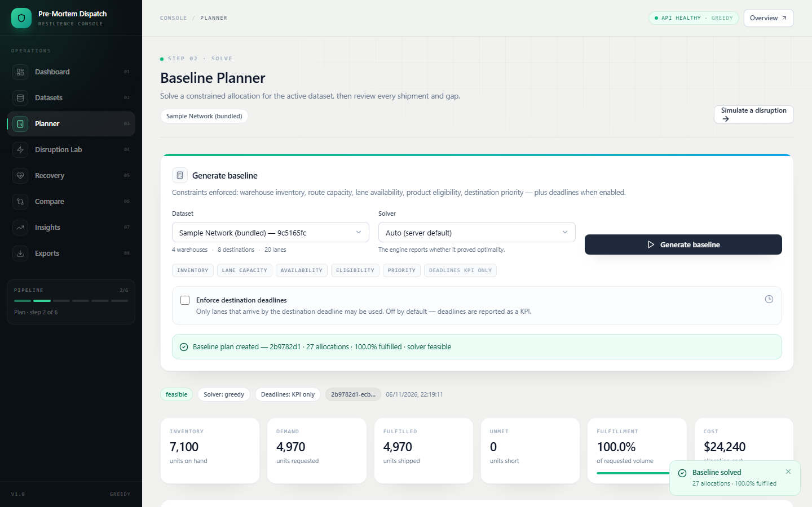 | 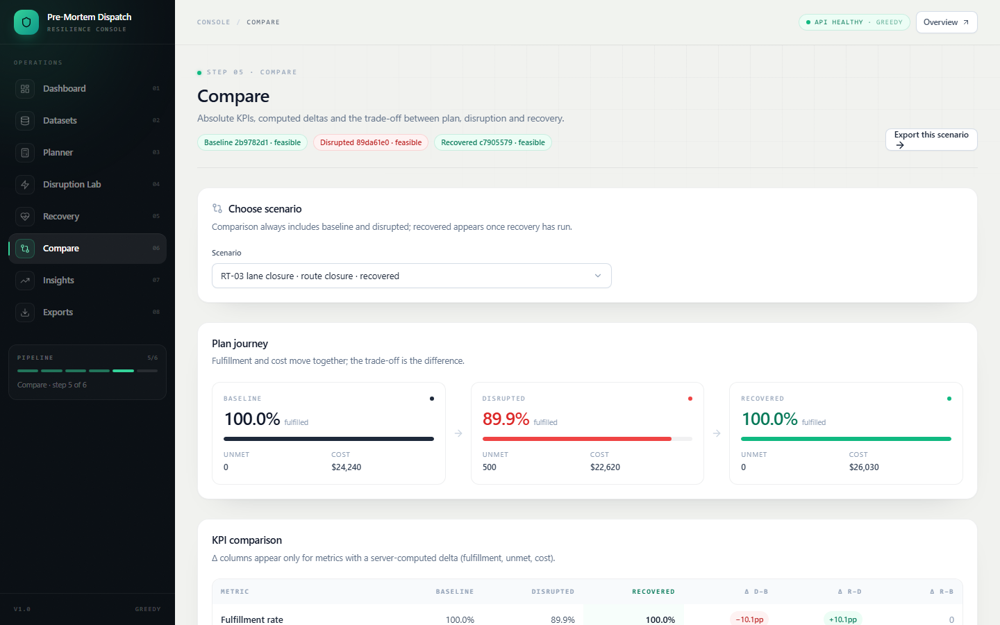 |
| **Planner** — allocations, gaps, risk breakdown | **Compare** — absolute values, deltas, deadline exposure |
| 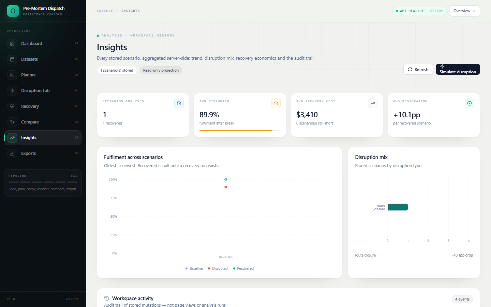 | 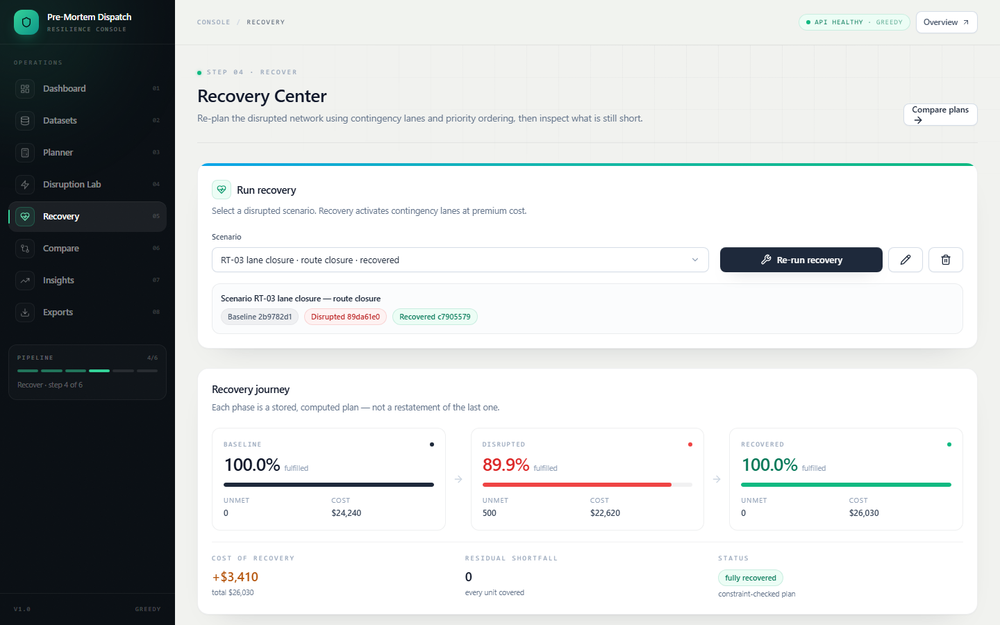 |
| **Insights** — server-aggregated trends, mix, recovery economics | **Recovery** — contingency actions, residual gaps, trade-off |

### Usability that survives a real workspace

The console is built for repeated use, not for one screenshot.

- **No native dialogs.** Renaming or deleting a dataset, plan or scenario opens an accessible
  modal — focus trapped, `Escape` or a backdrop click closes it, focus returns to the trigger.
  On a phone the same sheet docks to the bottom edge.
- **Feedback that stays.** Every mutation ends in a toast naming the object and what changed, and
  a refused delete surfaces the server's own reason instead of a silent failure.
- **Search where lists grow.** Datasets filter by name or id, baseline plans filter by plan id,
  solver or deadline policy, and the scenario selector on Recovery, Compare and Exports is a
  searchable combobox (type, arrow keys, `Enter`) rather than a native dropdown that hides
  everything past the first screenful.
- **Validation before submission.** The Disruption Lab rejects a stock reduction outside 0–100%
  or a delay outside 0–365 days in the field itself, with `aria-invalid` and an inline message,
  and disables Simulate / Add / Sweep until the input is legal.
- **Keyboard and screen-reader path.** A skip link, visible focus rings, `scope="col"` headers,
  `aria-live` toasts, named icon buttons (`Rename Sample Network (bundled)`) and reduced-motion
  handling are asserted by the browser suite, not just present in the markup.
- **Dense tables stay readable** — column headers stick while the allocation and gap lists scroll.

| | |
|---|---|
| 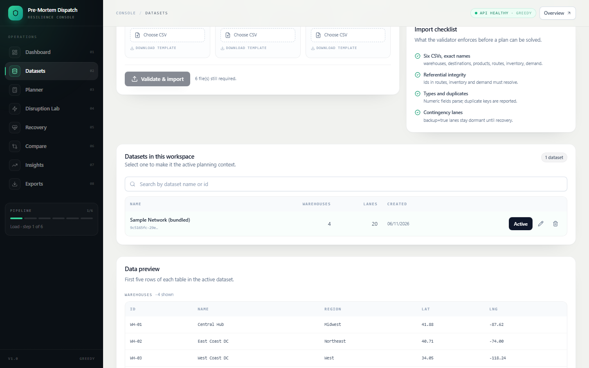 | 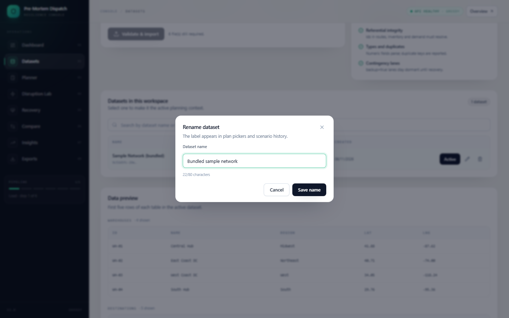 |
| **Datasets** — search, rename and delete in one list | **Modal rename** — focus trapped, `Escape` closes |
| 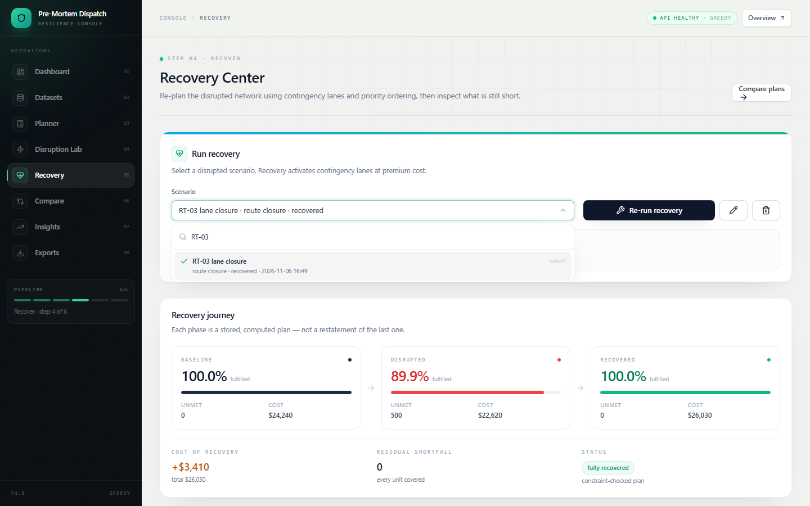 | 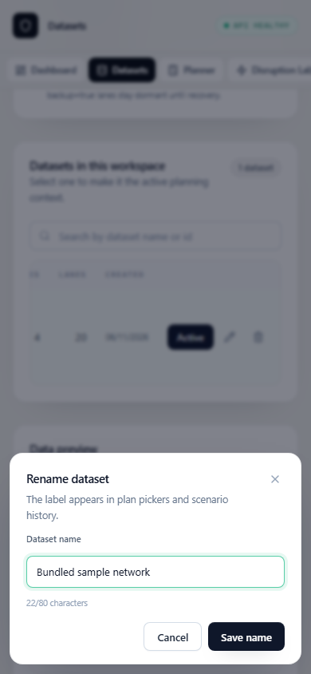 |
| **Scenario picker** — searchable and keyboard-driven | **Mobile** — the same dialog docks to the bottom |

Beyond the six steps, the console manages the workspace: rename or delete datasets (a delete
cascades through their plans and scenarios in one transaction), delete an unreferenced plan, and
inspect a server-recorded activity trail. `/insights` aggregates stored scenario history — trend,
disruption mix, recovery cost/restoration and the audit log — without recomputing plans at read
time.

Motion on the landing page: scroll-reveal per section, count-up statistics, an animated closed lane,
drifting aurora gradients, a marquee of modelled constraints, and cursor spotlights on cards. All of
it respects `prefers-reduced-motion`.

**Routes:** `/` landing · `/login` (auth/token entry) · `/dashboard` · `/datasets` · `/planner` ·
`/disruption` · `/recovery` · `/compare` · `/insights` · `/exports`

---

## Quick start

### Option A — two terminals (development)

```bash
# Terminal 1 — API
cd apps/api
pip install -r requirements-dev.txt
uvicorn app.main:app --reload --port 8000

# Terminal 2 — UI
cd apps/web
npm install
npm run dev            # http://localhost:5173
```

Open <http://localhost:5173>. No API key, no external service, no seed script.

### Option B — Docker Compose

```bash
docker compose up --build
# UI  http://localhost:5173
# API http://127.0.0.1:8000/docs   (loopback only; the web container proxies /api)
```

The SQLite database lives in the `pmd-state` named volume, so `docker compose down` keeps it and
`docker compose down -v` removes it. The API runs as a non-root user with a read-only root
filesystem; nginx serves the SPA, proxies the API, applies a CSP and rate-limits `/api/`.

For a gated deployment set `API_TOKEN` before starting (see [Production operation](#production-operation)).

### Optional: exact solver

```bash
pip install -r apps/api/requirements-ortools.txt
SOLVER=ortools uvicorn app.main:app --port 8000
```

Without it the greedy engine runs and `diagnostics.fallback` says so — the app never pretends
OR-Tools ran.

---

## Tests

```bash
# Backend: allocation invariants + full API workflow
python -m pytest apps/api/tests -q          # 95 passed

# Frontend typecheck + production build
cd apps/web && npm run build

# Browser E2E — starts the API and Vite itself, on a separate e2e database
cd apps/web && npx playwright test          # 15 passed
```

`playwright.config.ts` auto-starts both processes and reuses already-running servers locally, so
the E2E command needs no terminal setup. Set `E2E_DATABASE_URL` to isolate the run from
`apps/api/data/e2e.db`.

[`scripts/ci.sh`](scripts/ci.sh) runs tests, typecheck, build, browser workflow and container
builds locally. The GitHub Actions definition is kept at
[`docs/github-actions-ci.yml`](docs/github-actions-ci.yml) with a one-line enable command — the
current repository credential lacks the `workflow` OAuth scope needed to push that path.

[`apps/web/scripts/capture-docs.mjs`](apps/web/scripts/capture-docs.mjs) replays the demo path in
a browser and rewrites the screenshots above, so the images in this README are generated from the
same code the tests exercise rather than kept by hand.

The suite asserts invariants, not just "it returned 200":

- `Σ shipped ≤ inventory` per (warehouse, product) and `≤ capacity` per lane
- `allocated + unmet == demand` for every destination×product
- contingency lanes are **never** used by baseline/disrupted plans
- route closure removes the lane from the disrupted plan
- route delay preserves volume but raises deadline exposure (documented semantics)
- recovery restores fulfilment **and** costs more
- baseline is unchanged after a disruption is simulated against it
- identical inputs reproduce identical allocations
- equal-cost lanes are chosen deterministically, regardless of row order
- compound events apply in order; repeated shortages compound, repeated closures do not
- every unmet row carries a cause whose evidence matches the computed plan
- deleting a scenario removes its own plans but never the baseline
- deleting a dataset cascades through its plans and scenarios in one transaction
- plan deletion is refused while a scenario still references the plan
- rename and delete run through the in-app dialogs, and dataset search narrows the workspace list
- the first tab stop is the skip link, and `Escape` dismisses a destructive dialog
- the activity trail records mutations newest-first with structured detail
- insights aggregate stored KPIs into a chronological trend, disruption mix and recovery economics
- a severity sweep is monotonic for shortages, preserves volume for delays, and persists nothing
- hard deadline mode leaves late-only demand unmet; the default reports lateness as a KPI
- scenarios inherit the baseline's deadline policy
- concurrent SQLite writers wait for the lock instead of failing (WAL + busy timeout)
- every response carries a request id, and errors repeat it in the body
- exported CSV totals equal the computed plan totals
- the landing page's headline numbers match the demo story, and it has no horizontal overflow at 390 px

List endpoints report the true table count alongside `limit`/`offset`, so the UI never
mistakes a page for the whole history. `GET /health/ready` returns `503` when the database
probe fails; `/health` stays `200` and reports `degraded` so the UI can render the state.
`/health/live` checks the process only.

---

## Architecture

Modular monolith. `domain` → `services` → `routers`; the UI talks only HTTP.

```
apps/
  api/
    app/
      core/        config, error envelope
      domain/      schemas.py — single source of truth (Pydantic)
      routers/     health, auth, activity, analytics, datasets, plans,
                   scenarios, forecast
      services/    allocation, disruption, recovery, kpi, normalize,
                   validation, reporting, audit, ml/{interface,baseline}
      repo/        SQLite repository
    tests/
  web/
    src/           pages/, components/ui/, lib/api.ts, stores/
    e2e/           Playwright workflow spec
data/samples/      warehouses · destinations · products · routes · inventory · demand
docs/              architecture.md · api-contract.md · optimization.md · operations.md
```

Full detail — data flow, invariants, objective function, risk formula — in
[`docs/architecture.md`](docs/architecture.md), [`docs/optimization.md`](docs/optimization.md) and
[`docs/api-contract.md`](docs/api-contract.md). Deployment and incident handling live in
[`docs/operations.md`](docs/operations.md).

### Modelling decisions worth knowing

- **Objective** — minimise transport cost + a per-unit unmet penalty ($1000) weighted by
  destination priority. Fulfilling demand always beats saving freight.
- **Contingency lanes** — routes flagged `backup=true` are excluded from baseline and disrupted
  planning, and become available only during recovery at premium cost. This is what makes
  recovery a real optimisation change rather than a re-run.
- **Route delay** — raises `time_days` and therefore deadline exposure; it does **not** remove
  capacity, so fulfilment can stay at 100% while units arrive late. That is deliberate and stated
  in the UI.
- **Deadline policy** — deadlines are a KPI by default. Setting `respect_deadlines: true` when
  creating a plan turns them into a hard constraint: a lane may be used only when
  `time_days <= deadline_days`, and demand with no compliant lane is reported as unmet. Scenarios
  inherit the baseline's policy, so a deadline-enforced plan is never compared against a relaxed
  replan.
- **Feasibility ≠ optimality** — the greedy engine is feasible and priority-respecting, not
  proven optimal. Every plan displays its solver and status.

---

## Data format

Six CSVs, joined by ids:

```
warehouses.csv     id,name,region,lat,lng
destinations.csv   id,name,priority,region,deadline_days          # priority 1 = most critical
products.csv       id,name,unit,weight_kg
routes.csv         id,warehouse_id,destination_id,capacity,cost_per_unit,time_days,available,product_ids,backup
inventory.csv      warehouse_id,product_id,quantity
demand.csv         destination_id,product_id,quantity
```

`product_ids` may be blank (all products allowed) or a `;`/`,` separated list.
`backup` marks contingency lanes. Templates are downloadable from the Datasets screen.

---

## Configuration

Copy `.env.example` to `.env` at the repository root (the API and Vite both read it;
`apps/api/.env` also works for API-only overrides):

```ini
DATABASE_URL=sqlite:///./data/app.db
CORS_ORIGINS=http://localhost:5173,http://localhost:3000
SOLVER=greedy            # greedy | ortools | auto
LLM_ENABLED=false
API_PORT=8000
WEB_PORT=5173
MAX_UPLOAD_BYTES=5242880

# Production controls — all optional
API_TOKEN=               # set to require Bearer <token> / X-API-Key on /api/v1
ALLOWED_HOSTS=           # comma-separated Host allow-list; empty disables
DOCS_ENABLED=true        # set false to remove /docs and /openapi.json
SECURITY_HEADERS=true
LOG_LEVEL=INFO
APP_VERSION=1.0.0

VITE_LOGIN_URL=          # frontend only; defaults to /login
```

Uploads are capped per file and must be `.csv`. No secrets are required or committed.

### Access: open demo or operator token

By default the console is open — the single-operator demo needs no account. Set `API_TOKEN` to
gate every `/api/v1` route except health and auth discovery:

```bash
API_TOKEN="$(openssl rand -hex 24)" docker compose up --build
# then open /login and paste the same value, or call:
curl -H "Authorization: Bearer $API_TOKEN" http://127.0.0.1:8000/api/v1/plans/
```

The token is kept in `sessionStorage`, sent as a bearer header, and cleared when the tab closes.
It is a **deployment gate, not a user identity system** — there are no accounts or roles.

Authentication for real user accounts remains a separate Firebase workstream. The landing page
exposes **Sign in** in the header, the closing CTA and the footer:

| `VITE_LOGIN_URL` | Result |
|---|---|
| unset | Buttons point at `/login`, which handles both the token gate and the Firebase placeholder |
| `/login` or a hosted URL | Buttons point there directly |

To merge the Firebase module, replace the relevant branch of
[`LoginPlaceholder.tsx`](apps/web/src/pages/LoginPlaceholder.tsx) or set `VITE_LOGIN_URL` — the
console itself does not depend on it.

---

## Production operation

- **Health probes** — `GET /api/v1/health/live` checks the process, `/health/ready` checks the
  database and returns `503` when it is unreachable, and `/health` is the UI-friendly alias.
  Compose gates the web container on readiness.
- **Edge hardening** — nginx applies a CSP, frame/referrer/permissions headers, gzip, immutable
  asset caching, a 32 MB upload ceiling and per-IP rate limiting on `/api/`. The API adds
  no-sniff/frame/referrer/COOP headers and `Cache-Control: no-store` to API responses.
- **Traceable failures** — every response carries `X-Request-ID`; error envelopes repeat it, and
  the API access log prints the same id with method, path, status and duration.
- **Persistence** — Compose stores SQLite in the `pmd-state` volume. Back up by copying the
  database, not by relying on the container filesystem.
- **Honest scale limit** — one API worker against SQLite. Do not run multiple API replicas on the
  same file; Postgres remains on the roadmap.

Deployment details, backup commands and the incident checklist live in
[`docs/operations.md`](docs/operations.md).

---

## What this is not

- **Not** a claim of real-world optimality. It is a transparent model of a distribution network.
- **Not** forecasting. `GET /forecast` returns a labelled moving-average baseline (`model:
  "baseline"`). With no matching demand history it returns an empty series and
  `reason: "insufficient_history"` rather than inventing one. No trained model, no accuracy
  claim, and the allocator never consumes it silently.
- **Not** multi-user. `API_TOKEN` is a shared deployment gate, not accounts, roles or audit
  trails; real identity remains a separate Firebase workstream.
- **Not** LLM-dependent. An LLM may narrate computed results later; it is never the source of
  quantities, costs or feasibility.

## Roadmap without pretending

- Weight/volume constraints on lanes (product `weight_kg` is already captured)
- Trained demand forecasting once a real history exists, with backtested error
- Postgres + concurrent scenarios behind the existing repository interface
