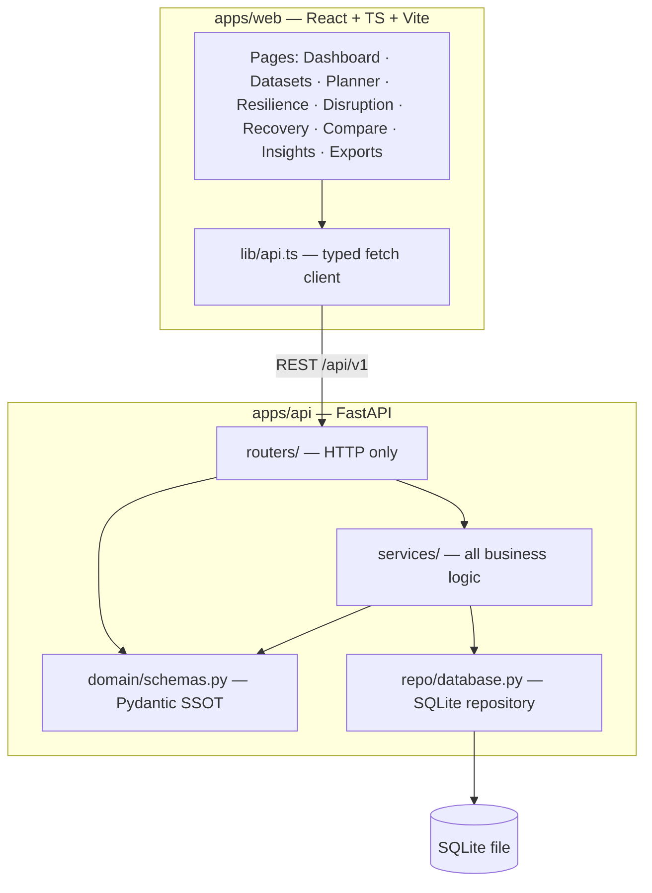
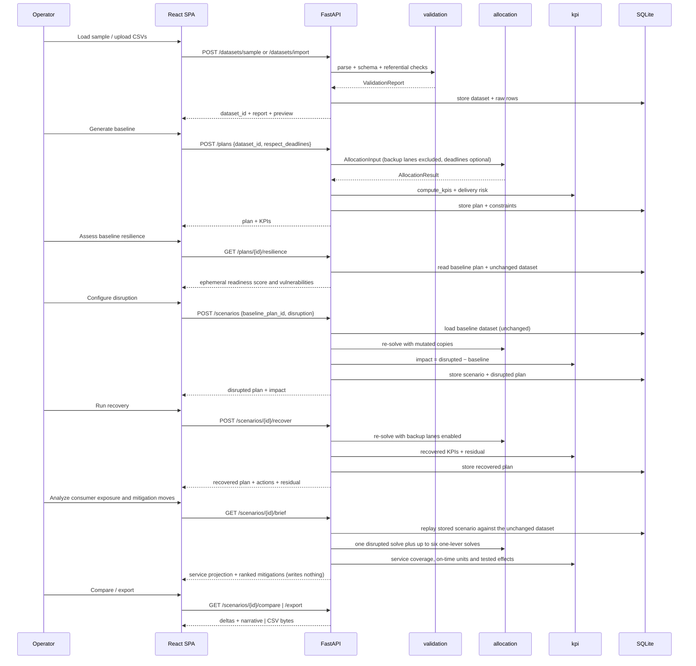

# Pre-Mortem Dispatch — Architecture

Single source of truth for boundaries, contracts and the reasoning behind them.

## 1. Shape of the system

A **modular monolith**: one FastAPI service and one React SPA, plus SQLite. No queues, no
microservices, no auth service. Every boundary below exists so that the parts can be built,
tested and replaced independently — not to distribute the deployment.

**Dependency rule.** `domain` depends on nothing. `services` depend on `domain`. `routers`
depend on `services` + `domain` and contain no allocation maths. The frontend depends only on
the HTTP surface — it never imports backend code.

**Operational boundaries.** SQLite runs in WAL mode with `busy_timeout=5000`, so a second
writer waits for the lock instead of failing; reads never block the writer. Every request gets
an id (`X-Request-ID`, echoed in errors) and a duration header, and is logged once. List
endpoints return the true table count with `limit`/`offset`; the API never presents a page as
the whole history.

## 2. Modules

| Module | Owns | Must not do |
|---|---|---|
| `routers/*` | HTTP shape, status codes, request validation | Business rules, solver logic |
| `services/allocation.py` | Greedy + optional OR-Tools allocation | Touch HTTP, format responses |
| `services/disruption.py` | Mutating planning inputs on copies | Mutate the caller's objects |
| `services/diagnosis.py` | Explain every unmet row from the inputs + result | Change feasibility or invent causes |
| `services/recovery.py` | Recovery re-plan and allocation diff | Claim success when infeasible |
| `services/resilience.py` | Baseline redundancy, headroom and deadline-margin assessment | Persist or mutate planning state |
| `services/advisory.py` | Consumer service projection and isolated solver-tested mitigations | Recommend an effect the re-solve did not achieve |
| `services/sensitivity.py` | Severity sweeps over one disruption | Persist results or change policy |
| `services/kpi.py` | KPI + delivery-risk + risk score | Depend on persistence |
| `services/normalize.py` | CSV row → typed domain object | Silently drop rows |
| `services/validation.py` | CSV parsing + schema/referential checks | Persist anything |
| `services/reporting.py` | CSV export bytes | Recompute metrics |
| `repo/database.py` | Persistence | Contain business rules |
| `core/*` | Config, errors | Domain logic |

## 3. Data flow

## 4. Key invariants

1. **Baseline immutability.** A disruption never writes to the baseline plan or dataset. It
   reads the dataset, deep-copies the inventory and routes, mutates the copies, and solves.
   Verified by `test_disruption_does_not_mutate_baseline`.
2. **Conservation.** For every (destination, product): `allocated + unmet == demand`.
   Verified by `test_conservation_demand_equals_allocated_plus_unmet`.
3. **Capacity.** For every route: `Σ shipped ≤ capacity`. For every (warehouse, product):
   `Σ shipped ≤ inventory`. Verified in `test_baseline_respects_inventory_and_route_capacity`.
4. **Reproducibility.** Same dataset + same solver ⇒ identical allocations and cost.
   Verified by `test_plan_creation_is_reproducible`.
5. **Honest infeasibility.** If demand cannot be covered, residual unmet rows are returned and
   explained. No synthetic success.
6. **Policy inheritance.** A baseline plan stores `constraints.respect_deadlines`; scenarios and
   recovery re-read it from the baseline. A deadline-enforced plan is never compared against a
   relaxed replan. Verified by `test_plan_endpoint_enforces_and_scenarios_inherit_the_policy`.
7. **Deterministic lane choice.** Equal-cost lanes are ordered by route id, so re-importing the
   same data in a different row order cannot silently change which lane is used.
8. **Ordered compound events.** Up to five disruptions are applied sequentially to deep copies;
   later events see earlier effects. The original dataset and baseline plan are never mutated.
   Verified by `test_sequential_shortages_compound_and_leave_originals_untouched`.
9. **Evidence-based diagnosis.** An unmet cause is only reported when the inputs support it
   (missing lane, product filter, deadline, stock, capacity, or consumption by earlier demand),
   and the evidence object carries the numbers used to decide.
10. **Safe deletion.** Deleting a scenario removes only the disrupted/recovered plans it owns in
    one transaction; the baseline plan always survives. Verified by
    `test_delete_scenario_removes_owned_plans_but_keeps_baseline`.
11. **Ephemeral sweeps.** A sensitivity sweep re-solves the same network at each severity with
    the baseline's solver and deadline policy, and writes nothing to the database. Verified by
    `test_shortage_sweep_degrades_fulfillment_and_stores_nothing`.
12. **Ephemeral intelligence.** Resilience and scenario briefs recompute from stored inputs,
    write no plan, scenario or activity record, and report a mitigation only when the re-solve
    actually improves its projected effect. Verified by `test_resilience.py`.

## 5. Recovery model

Recovery is not "run the solver again". Two levers are genuinely applied:

1. **Contingency lanes** (`route.backup = true`) are excluded from baseline and disrupted
   planning, then made eligible during recovery at their premium `cost_per_unit`. This models a
   contracted backup carrier: dormant normally, expensive when activated.
2. **Priority ordering** — demand is served by destination priority (1 = most critical), so
   scarce capacity protects critical destinations first.

Evidence for the demo: closing `RT-03` drops fulfillment 100 % → 89.9 %; recovery re-activates
`RT-13` and restores 100 % for **+$3,410**.

If the network truly cannot cover demand, recovery returns the same residual and the comparison
narrative names the specific destination×product gaps. Each residual row also carries a
structured diagnosis (for example `contingency_only`, `deadline_blocked`, `capacity_shared`) with
the numbers behind it, so the UI can explain the binding constraint instead of listing a number.

### 5.1 Compound scenarios

A scenario may combine 1–5 disruptions. They are applied in order to deep copies, so effects
compose: two shortages on the same stock compound, and a repeated closure is idempotent. A single
event keeps the plain stored shape; combinations are stored as
`{"type": "compound", "events": [...]}` and replayed identically during recovery. Scenario names
are optional, and deleting a scenario deletes its own plans but never the baseline.

## 6. Deliberate omissions

| Not built | Why |
|---|---|
| Auth / RBAC | Single-operator demo; no requirement in the workflow |
| Postgres | SQLite behind `repo/` is enough; swap is a config change |
| Microservices / queues | Adds failure modes, no benefit at this scale |
| LLM as source of truth | All figures are computed; an LLM may only narrate them |
| Forecasting | No time-series history exists; treating uploaded snapshots as periods would fabricate a trend |
